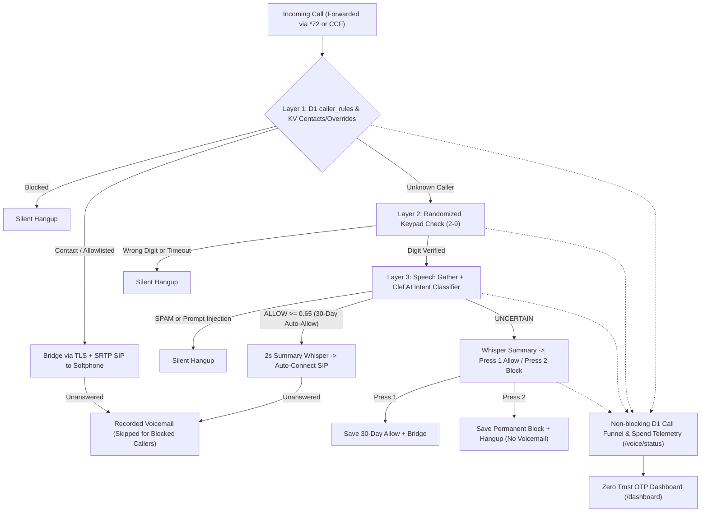

# You Shall Not Ring

[](https://github.com/dubiza/you-shall-not-ring/actions/workflows/ci.yml)
[](LICENSE)

**A 3-layer AI spam-call firewall for your mobile phone**, built on **Cloudflare Workers**, **Cloudflare D1**, **Workers KV**, **Workers AI (`@cf/cloudflare/clef`)**, **Cloudflare Zero Trust Access (Email OTP)**, **Twilio Programmable Voice**, and an encrypted **TLS/SRTP SIP** softphone (such as **Acrobits Groundwire** on iOS).

Unknown callers face a randomized human-verification challenge and spoken intent classification before your phone ever rings—plus a private call-whisper confirmation before the caller is connected to you. Known contacts and allowlisted callers ring straight through seamlessly.

---

## Architecture



---

## Key Features

* **Layer 1 — Hybrid Allowlist & Privacy-Preserving Contacts Sync:**
  * Checks **Cloudflare D1 (`caller_rules`)** first for manual dashboard rules, CSV-imported contacts, 30-day AI/whisper auto-approvals, and permanent blocks.
  * Falls back to **Workers KV (`ALLOWLIST_KV`)**, where an iOS Shortcuts automation syncs your phone's address book as a single JSON snapshot of **salted 128-bit HMAC-SHA256 digests** (`1` KV write per sync, zero plaintext contacts stored in KV).
* **Layer 2 — Randomized Keypad Gate (`2–9`):**
  * Automatically drops autodialers, silent robocalls, and bots pressing `0`/`1` by asking callers to press a freshly randomized digit (`2–9`).
* **Layer 3 — Speech Screening with Cloudflare Clef (`@cf/cloudflare/clef`):**
  * Clean speech-only prompt with one polite retry on silence, evaluated in parallel for routing (`allow` / `spam` / `uncertain`), caller category (recruiter, buyer, delivery, appointment, contractor, billing, loan scam, vendor pitch, etc.), and `prompt_injection` score—with deterministic keyword/uncertain fallback if Workers AI is unavailable.
* **Custom Name Pronunciation (SSML IPA):**
  * Optional `ownerNameIpa` setting wraps your name in Amazon Polly SSML `<phoneme alphabet="ipa" ph="...">` tags so voices pronounce it consistently in every prompt and voicemail greeting.
* **Interactive Whisper & Voicemail Control:**
  * `ALLOW` calls get a 2-second summary whisper and auto-connect + 30-day allowlist. `UNCERTAIN` calls let you **Press 1** to accept (30-day allowlist) or **Press 2** to permanently block without offering voicemail.
* **Zero Trust Analytics & Allowlist Dashboard (`/dashboard`):**
  * Secured behind **Cloudflare Zero Trust Access (Email OTP)** and verified in-Worker with **Web Crypto `RS256` JWT validation** against your team's JWKS.
  * Shows KPI cards, a call-screening phase funnel (seeing whether callers stopped at L1, wrong/abandoned L2 keypad, L3 Clef AI, or whisper), call duration and usage telemetry via `/voice/status`, searchable call logs with transcripts, one-click Allow/Block overrides, and a bulk CSV importer/exporter.

---

## Tech Stack

| Layer | Technology | Role |
| :--- | :--- | :--- |
| **Edge Runtime** | Cloudflare Workers (TypeScript) | Handles Twilio webhooks, SIP TwiML responses, Admin API, and Dashboard UI. |
| **Relational Storage** | Cloudflare D1 | Stores `call_logs` (90-day retention) and `caller_rules` (CSV, manual, AI/whisper allow/block). |
| **Edge Key-Value Store** | Workers KV | Stores salted 128-bit HMAC contact snapshots, fallback overrides, and short-TTL keypad/whisper state. |
| **Intent Classification** | Workers AI (`@cf/cloudflare/clef`) | Classifies caller speech intent and detects prompt-injection attempts in parallel. |
| **Dashboard Auth** | Cloudflare Zero Trust Access (Email OTP) | Gates `/dashboard` and `/dashboard/api/*` with edge OTP + in-Worker `RS256` JWT validation. |
| **Telephony & Transport** | Twilio Programmable Voice + TLS/SRTP SIP | Runs IVR DTMF/speech prompts, status callbacks, voicemail recording, and encrypted SIP bridging. |
| **Mobile Softphone** | Acrobits Groundwire (iOS) | Receives screened, allowlisted, and whisper-confirmed calls over TLS/SRTP. |

---

## Quick Start

### Prerequisites
* Node.js 22+ (Node 24+ recommended for running the local SQLite-backed Vitest suite)
* A [Cloudflare](https://dash.cloudflare.com/) account (`cf` CLI is included in `devDependencies`)
* A [Twilio](https://www.twilio.com/) account with a Programmable Voice phone number and a TLS/SRTP-enabled SIP Domain
* A SIP softphone on your mobile device (tested with **Acrobits Groundwire** on iOS over TLS + SRTP)

### 1. Clone, Install, and Configure Your Private Instance Files

```zsh
git clone https://github.com/dubiza/you-shall-not-ring.git
cd you-shall-not-ring
npm install
cp local.config.example.json local.config.json
cp .dev.vars.example .dev.vars
```

Edit **`local.config.json`** (gitignored—never committed) with your Worker name, D1 database name, spoken name (plus optional Amazon Polly en-US IPA string), and Zero Trust Access team domain (`your-team.cloudflareaccess.com`).

Edit **`.dev.vars`** (also gitignored) with your runtime secrets:
* `TWILIO_AUTH_TOKEN` — Twilio Console → Account Info → Auth Token
* `SIP_ENDPOINT` — e.g. `sip:you@your-domain.sip.us1.twilio.com;transport=tls;secure=true`
* `ADMIN_TOKEN` — generate with `openssl rand -hex 32`
* `CONTACT_HASH_SALT` — generate with `openssl rand -hex 32`
* `CF_ACCESS_AUD` — filled in after Step 3 below

### 2. Deploy Worker & Initialize Cloudflare D1

```zsh
npx cf login
npx cf deploy --secrets-file .dev.vars
npx cf d1 list
npx cf d1 migrations apply <YOUR_D1_DATABASE_ID>
```

### 3. Protect `/dashboard` with Path-Scoped Cloudflare Zero Trust Access (Email OTP)

> [!IMPORTANT]
> Gate **only `/dashboard` and `/dashboard/*`** in Cloudflare Access. Do **not** enable Worker-wide Access on the entire Worker—Twilio's `/voice/*` webhooks and your iOS Shortcut's `/admin/*` sync must reach the Worker directly, where they authenticate with `X-Twilio-Signature` and `ADMIN_TOKEN`.

1. In **Cloudflare Dashboard → Zero Trust**, initialize your team and ensure **One-time pin** is enabled under **Settings → Authentication → Login methods**.
2. Go to **Access → Applications → Add an application → Self-hosted**.
3. Protect both paths on your Worker domain:
   * `<your-worker>.<your-team>.workers.dev/dashboard`
   * `<your-worker>.<your-team>.workers.dev/dashboard/*`
4. Add an **Allow** policy restricted to your personal email address(es) using **One-time pin**.
5. Copy the application's **AUD tag**, add `CF_ACCESS_AUD=...` to `.dev.vars`, ensure `cfAccessTeamDomain` is set in `local.config.json`, and redeploy:

```zsh
npx cf deploy --secrets-file .dev.vars
```

### 4. Configure Twilio Programmable Voice

In **Twilio Console → Phone Numbers → Manage → Active Numbers**, select your screening number:
* **A call comes in:** `https://<your-worker>.<your-team>.workers.dev/voice/incoming` (`HTTP POST`)
* **Call status changes:** `https://<your-worker>.<your-team>.workers.dev/voice/status` (`HTTP POST`)

Then enable carrier forwarding (`*72` unconditional forwarding for `"all"` mode, or Conditional Call Forwarding for `"ccf"` mode) from your phone to your Twilio number.

### 5. Optional: Daily iOS Shortcuts Contacts Sync

Create an iOS Shortcut with these actions:
1. **Find Contacts** (all contacts)
2. **Get Phone Numbers from Input** (`Contacts`)
3. **Combine Text** (`Phone Numbers` with `New Lines`)
4. **Get Contents of URL** (`POST` to `https://<your-worker>.<your-team>.workers.dev/admin/contacts-sync`, headers `Authorization: Bearer <ADMIN_TOKEN>` and `Content-Type: application/json`, JSON body field `numbers` = `Combined Text`)

Run once manually to tap **Always Allow**, then schedule a daily silent **Time of Day** automation.

---

## Local Development & Verification

```zsh
npm run typecheck   # Generate Worker types and run strict TypeScript check
npm test            # Run full Vitest unit & SQLite integration suite
npm run build       # Build Cloudflare Worker edge bundle
npm run dev         # Run local Worker dev server via cf CLI
```

### Day-to-Day Iteration (Single Branch)

Because `local.config.json` and `.dev.vars` stay gitignored while your code lives on `main`:
1. Edit source files on `main` and run `npm run typecheck && npm test`.
2. Deploy updates to your personal Worker with `npx cf deploy`.
3. Commit and push open-source improvements cleanly without exposing personal domains, names, or tokens.

---

## Security Design

* **Webhook & Admin Auth:** `/voice/*` validates Twilio's `X-Twilio-Signature` (`HMAC-SHA1`); `/admin/*` uses constant-time `ADMIN_TOKEN` Bearer comparison.
* **Dashboard Zero Trust Verification:** `/dashboard` and `/dashboard/api/*` enforce edge Cloudflare Access OTP plus in-Worker Web Crypto `RS256` JWT validation (`iss`, `aud`, `exp`, `nbf`, cached JWKS) and fail closed (`503`) if Access configuration is missing.
* **Prompt-Injection Defense:** Clef evaluates a dedicated `prompt_injection` score in parallel with caller intent, immediately dropping attempts to manipulate routing decisions, and all dynamic UI/TwiML text is strictly escaped.

## Contributing & Security

* **Contributing:** PRs and bug reports are welcome—please read [CONTRIBUTING.md](CONTRIBUTING.md) before opening a pull request.
* **Security:** Please report security vulnerabilities privately via [SECURITY.md](SECURITY.md) rather than opening a public issue.

## License

[MIT](LICENSE)
